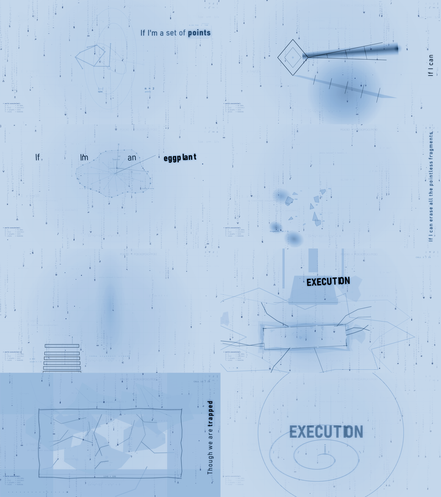

# world.execute(me); — 矩阵 / the matrix

一部 **3 分 31.9 秒**的实时网页动画 MV。**双击 `index.html` 即可播放**：
不装依赖、不构建、不起服务器、不联网。音频文件与 `index.html` 同级。

> **2026-10-27 视觉改版**：删除了点光源（shadow-play 的那盏灯）与皮影戏语言。
> 不再有墙、投影、影子、烛光，也没有任何物体被"照亮"——画面是**灰白纸面上的科技蓝墨线/字**
> （内部仍按自发光渲染，再由皮肤层反相成纸面墨迹），外面叠一层代码雨、扫描线、浮尘。旧的"影戏"版本已封存于
> `archive/2026-10-26-silhouette-v1/`。



---

## 1. 这是什么

Mili《world.execute(me);》的一次独立视觉诠释。

我把它读成一段**在矩阵里执行的代码**：机器不是投在墙上的影子，而是一段
**自己发光**的数据——点、圆、正弦、极限、名词，全是它写给自己看的线框与读数。
没有外部光源，没有可以被"看见"的实体，只有纸面上的蓝墨水迹；它一次次把自己拆成
可以被定义的参数，最后用最后一行 `EXECUTION` 关掉自己。

> 全片 100 个镜头（cue），每一句歌词一块画板，纯音乐与处决风暴单独拆点。
> 动画、引擎、构建与验收工具链为原创实现；音乐与歌词版权归 Mili。

## 2. 快开始

```
双击 index.html
```

| 操作 | 键 |
| --- | --- |
| 播放 / 暂停 | `空格`（或点画面） |
| 后退 / 前进 5 秒（±1 秒加 Shift） | `←` / `→` |
| 毫秒同步偏移 ±10ms（±1ms 加 Shift） | `,` / `.` |
| 偏移归零 | `/` |
| 重播 / 全屏 / 隐藏界面 / 调试叠层 | `R` / `F` / `H` / `D` |
| 音量 | `↑` / `↓` |
| 跳到开头 / 结尾 | `Home` / `End` |

> GitHub 仓库不含原曲 mp3（版权原因）。把 `Mili - world.execute(me);.mp3` 放到根目录即可播放；音频也需与 `index.html` 同级。

音频文件名：`Mili - world.execute(me);.mp3`。若移动了文件，页面会依次尝试几个常见文件名，
也可以把音频改名成 `audio.mp3` 放在旁边。

## 3. 系统（这才是这部片子的"代码驱动"）

### 一个时钟
```
t = audio.currentTime + syncOffset
```
渲染循环不累计自己的时间、不数帧。**每一帧都是 t 的纯函数**：没有跨帧状态、没有 `Math.random()`，
所有"随机"都是 `hash(序号)`。所以暂停、继续、任意拖动、乱序跳转之后，画面逐字节复原。
（验收里有一条：同一 t 反复渲染、乱序跳转后逐帧比对，全部一致。）

### 没有光源
**没有点光源，也没有投影仪。** 画面内部仍是"自发光"渲染（线、字、读数都是亮绿/
青绿的 emission，没有被任何物体照亮），但**皮肤层把它反相成灰白纸面上的科技蓝墨迹**：
`#view` 用 `invert(1) grayscale(1)` 变成纸+灰墨，`#stage::after` 用 `mix-blend-mode:color`
把墨迹统一染成科技蓝（只改色相、不改明度），`#stage::before` 再压一点蓝让纸面有重量。
代码雨/浮尘也改成深蓝并改用 `multiply`，叠在纸面上像蓝色油墨。旧的 `lamp = {x,y,z,lux,k}` 只作为常量占位留在
世界状态里（`{0, 0, 900, .8, .3}`），`D.cast / D.body` 不再做中心投影与缩放，
`EM.W.light()` 是空函数——灯、墙、灼痕、烛焰、灯下尘埃都已删除。
外面另有三个纯装饰层：代码雨（`src/matrix.js`）、冷色萤火（`src/fireflies.js`）、
CRT 扫描线（`src/style.css`），它们的每一帧同样只取决于本片的 t。

### 一条世界曲线
`src/01_world.js` 由 `_build/world-anchors.js` 生成：`order / chaos / warm / love / trace /
dust / burn / voidSize` 都是"在这句歌词时世界是什么样"的关键帧曲线；
调色板 `PAL(w)` 由这些参数插值（内部仍是黑→磷光绿的色阶，再由皮肤统一反相成蓝墨）。**画板不自己挑颜色**——
这是 100 块画板看起来像一部片子的原因。

### 一句一块画板
`src/40–46_plates_*.js` 共 100 块，按幕分开。**每两句之间都有过渡动画**（不是硬切）：
`src/15_sceneapi.js` 的过渡导演把上一块与下一块分别渲到两张半分辨率离屏画布
（960×540），再用 10 种效果之一合成；每一帧仍只由 t 决定，可任意 seek。

| # | 效果 | 说明 |
| --- | --- | --- |
| 0 | fade | 纯交叉淡变，最安静的一种 |
| 1 | slice | 18 条横带错峰滑动切换 |
| 2 | tile | 12×7 网格按 hash 阈值逐格翻转 |
| 3 | wipe | 左右/上下软擦除，带一条高光扫描边（方向随句变化） |
| 4 | bars | 14 条竖条交错上下滑动 |
| 5 | zoom | 旧画面推近、新画面从 1.16 倍落到 1，带一次短曝光 |
| 6 | rgb | 青色重影 + 几条撕裂带的中断切换 |
| 7 | glyph | 代码雨幕（下落字形 + 暗场压一层）拉开两段 |
| 8 | iris | 圆形/椭圆软光圈从画面某处展开，带一圈绿环 |
| 9 | punch | 硬切冲击：短促缩放 + 曝光，用于同镜头重复与处决段 |

时长不是固定的：普通句 0.5–0.7s、缺席幕 ~0.9s、爱幕 ~1.05s、处决段 0.3s
（`bleed=false` 的 16 次冲击用 0.17s 的 punch/strike，不拖泥带水），幕与幕之间 ×1.22 并
优先挑更"电影感"的效果（glyph/iris/zoom/wipe/tile）。效果类型由 `cue.i` 决定，
动画只由 t 与 onset 驱动——同一条边界每次播放都同一效果、同一节奏。
（`_tools/shot-xf.js` 可给每种效果出图，`_tools/bench-xf.js` 量过渡期间帧率。）

### 歌词是排版，不是字幕
**没有中文字幕，也没有固定的底部歌词条。** `src/35_motifs.js` 里的 lyric director 按
`cue.i % 7` 给每一句分配一种"排版情境"，位置/方向/尺度因此逐句变化：

| 情境 | 做法 |
| --- | --- |
| 0 hero | 大字号居中，按句长自动换行，关键词加粗并在词下加一条 1px 细线 |
| 1 / 2 stack | 左/右贴边竖排短行，旁边挂一条细竖线当"版心线" |
| 3 banner | 顶部小号等宽全大写，tracking 拉到 12–20（像片头字幕卡） |
| 4 vertical | 沿画面左右边缘旋转 90°，竖排读下来 |
| 5 scatter | 每个词单独落在不同基线上，像海报字被吹散 |
| 6 echo | 在正常字号后面压一层 2.15 倍的巨大幽灵字（alpha≈0.09） |
| 8 instr | 纯音乐段不放歌词，只在角落放一行 mono 小注 + 双细线 + 时间码 |

每个词单独入场：透明度 + 位移 + tracking（字母间距从宽收拢），强 onset 时叠一层青色
重影（chromatic ghost）并把 tracking 再推一点。关键词（eggplant / cat / love /
EXECUTION…）自动加粗、变亮、加下划线；处决幕的关键词混入红色。
整句还会带一行"编辑标记"（细线 + `时间 / 幕`），位置跟着排版情境走。
所有样式由 `cue.i` 决定、所有动画只由 `p` 与 onset 驱动——仍然满足"同一 t 逐字节一致"。

### 歌词里的物品，是生成的图
歌词点到的东西都做成了图（透明的蓝图线稿，白线，皮肤反相后就是纸上的蓝墨）：
茄子、番茄、虎斑猫、神（抽象的眼睛+∃!）、营养向量（抽象液滴与键）、抗氧化分子（六元环+轨道）。
生成脚本 `_tools/gen-objects.js` 用 Playwright 画 6 张 1024×1024 PNG，存到 `assets/objects/`，
并写一份 base64 的 `assets/objects.js`（`file://` 下外链图片会污染 canvas，data URI 不会）。

它们由 `src/36_objects.js` 放进动画：按 cue.text 匹配（eggplant / nutrients / tomato /
antioxidants / tabby cat|purr / god），每句给**一个大的幽灵标本**（位置/大小/旋转由 cue.i 决定，
缓慢呼吸、随句进度漂移）+ **一张角落的标本卡**（细角标、`SPEC 05 / FELIS CATUS`、扫描读数、
一条连向幽灵的测量线）。卡片会避开歌词所在的那一侧；`god` 在缺席幕
（"Challenging your God"）也会再次出现。物品层在画板层之内绘制，所以过渡帧里也一起被合成。
一切都是 t 与 cue 的纯函数：可 seek、可逐帧导出。

### 卡点是真的
`_build/parse-mp3.js` 自己解析 MP3 帧头（8114 帧 × 1152 / 44100，扣 LAME delay/padding = **211.912857s**），
并用 FFT 频谱通量提取 **871 个 onset**（时间、主频、力度、能量）。
处决风暴的 16 次冲击不是手写网格，是**吸附到真实重音**上的。

## 4. 结构

| 幕 | 时间 | 它想干什么 | 画面 |
| --- | --- | --- | --- |
| 0 启动 | 0:00–0:16 | 给自己下定义 | 上电、参数刻度、尘埃 |
| 纯音乐 | 0:16–0:29 | 世界自转 | 环/摆/点在自己的轨道上运行 |
| I 定理 | 0:29–0:59 | 用几何证明自己有用 | 命题被画出来、被读数测量 |
| II 条件 | 0:59–1:14 | 交易与讨价还价 | 分支、窄门、框、牢笼 |
| III 血肉 | 1:14–1:43 | 名词突然活了 | 机器没有 schema 的输入：成形、失败、再试 |
| IV 缺席 | 1:43–2:27 | 可计算性失效 | 洞、空轮廓、消失的碎片、崩坏的数据 |
| V 处决 | 2:27–2:57 | 从乞求到起诉 | 16 次冲击，画面被盖章/裂开 |
| VI 爱 | 2:57–3:32 | 它研究了爱 | 烛光、手写的线、一个不会闭合的环 |

## 5. 构建与验收

```
node _build/parse-mp3.js      # mp3 -> assets/onsets.js + assets/waveform.js
node build.js                 # cue 表 + 世界曲线 + 注入歌词 + 一致性检查
node _tools/verify.js         # 静态检查 + 确定性 + 全片无空帧抽查
NODE_PATH=... node _tools/verify-browser.js   # 真浏览器：逐句出图、乱序 seek、fps、音频
NODE_PATH=... node _tools/bench-xf.js        # 过渡期间帧率（播放 56–63s 的连续边界）
```

```
node _tools/render.js --times 30,75,158 --out frames/a     # 指定秒数导出静帧
node _tools/render.js --prefix thm. --out frames/thm        # 按幕导出
node _tools/render.js --sheet --out frames/thm              # 接触印相
node _tools/render.js --scenes thm.sine --p 0.5 --t 37.15 --out frames/x
```

### 导出成 MP4
逐帧渲染（确定性：每次 `EM.MV.renderAt(t)` 后等两帧 rAF 让代码雨/萤火落到该 t，
再整页截屏，CSS 皮肤一起进画面），然后用 ffmpeg 合成（1920×1080 / 24fps / H.264 / AAC）：

```
NODE_PATH=... node _tools/render-mp4.js 24 frames/video     # 5086 帧，约 15–18 分钟，可断点续渲
node _tools/encode-mp4.js 24 frames/video "world.execute(me)-matrix-1080p24.mp4"
```

`render-mp4.js` 会跳过已存在的帧，所以中断后重跑会接着渲；`encode-mp4.js` 负责 BT.709
色域转换、AAC 192k 和 `+faststart`（网页拖动更快）。导出的片子在
`world.execute(me)-matrix-1080p24.mp4`。

## 6. 文件

```
index.html                 外壳 + 内嵌歌词（由 build 生成）
index.src.html             外壳源文件
assets/onsets.js           871 个卡点 [ms, f0, vel, energy]
assets/waveform.js         实测时长 + 512 格能量包络
assets/timeline.js         100 条 cue（由 _build/cue-sheet.js 生成）
assets/objects.js          6 个歌词物品的 PNG（base64 data URI，由 _tools/gen-objects.js 生成）
assets/objects/*.png       同样的线稿原图（透明底，1024²）
src/00_core.js             确定性内核：数学、缓动、颜色、哈希、卡点钟
src/01_world.js            生成：世界曲线 + 调色板
src/10_draw.js             绘图套件（无投影，平面直绘）+ 文字
src/15_sceneapi.js         画板注册表 + 过渡导演（10 种效果、离屏合成）+ 失败上报
src/20_lyrics.js           cue 运行时
src/30_world.js            纸面 / 数据网格 / 尘 / 片尾字 / 后处理（无灯、无墙、无灼痕）
src/35_motifs.js           共享母题（点阵、量尺、印章、手写线…）+ lyric director
src/36_objects.js          歌词物品层：幽灵标本 + 角落标本卡（确定性排版）
src/40–46_plates_*.js      100 块画板
src/60_app.js              引擎：单一时钟、rAF、传输控件、调试、无头钩子
src/matrix.js              装饰层：代码雨 + 公式/读数 HUD（确定性，随 t）
src/fireflies.js           装饰层：冷色萤火（确定性，随 t）
src/style.css              皮肤：反相纸面 + 科技蓝（color/multiply）、扫描线、界面配色
_build/                    素材 -> 数据管线
_tools/                    验收、静帧、过渡、物品图、成片导出工具
_tools/render-mp4.js       逐帧渲染 PNG 序列（可断点续渲）
_tools/encode-mp4.js       PNG 序列 + mp3 -> H.264/AAC mp4
```

## 7. 版权

- 音乐、歌词版权归 **Mili** 所有，随目录分发仅为让演示能直接双击运行。
- 动画、引擎、构建与验收工具链为本项目原创实现，非官方 PV，与 Mili 无隶属关系。
- 方法上参考了 `Galen563/world.execute-me` 的工程骨架（单一时钟、确定性渲染、画板注册表、
  世界状态曲线、"验证画出来了而不是注册了"），**画板、世界层、绘图内核、构建与验收工具链均为重写**，
  视觉语言与叙事是另一套。

---

## 8. 这一版的验收结果

```
100 cue / 100 画板，全部有画面
确定性：同一 t 重复渲染、乱序 seek（150→12.5→206→60→177.4→12.5→60）后逐帧一致
无空帧：逐句 55% 处采样，全部有内容（mean / max 亮度检查）
无画板异常；无 console error
真浏览器播放：<audio> 就绪、duration 211.91s、file:// 正常
帧率：headless Chrome 约 120–145 fps（1920×1080）
```

## 9. 图

`media/` 下是随仓库保留的成品图（检查用的临时截图已于 2026-10-27 瘦身时清理）：

| 文件 | 内容 |
| --- | --- |
| `media/hero-sheet.png` | 科技蓝版主视觉 2×4（1920 静帧） |
| `media/opening.png` | 开场界面 |
| `media/lyrics-sheet.png` | 歌词排版 4×4（逐句式版式） |
| `media/transitions-sheet.png` | 10 种过渡效果定格 |
| `media/objects-sheet.png` | 6 个歌词物品（幽灵标本 + 标本卡） |
| `media/mp4-compare.png` | 成片抽帧 vs 源 PNG |

重新生成静帧：

```
NODE_PATH=<npx node_modules> node _tools/shot-hero.js
NODE_PATH=<npx node_modules> node _tools/shot-mx.js blue-final 8,30,60,75,90,120,150,175,206,210
NODE_PATH=<npx node_modules> node _tools/shot-xf.js xf3 0.42
```

工具依赖（只有跑工具时需要，播放不需要）：Node 18+、Chrome、ffmpeg；
批量静帧用 Playwright（`NODE_PATH` 指向任意 `npx playwright` 的 node_modules 即可）。

> **仓库说明**：GitHub 仓库只放代码、素材脚本、文档与 `media/` 成品图。
> 原曲 mp3、导出的 mp4、旧版归档与检查截图都不上传（见 `.gitignore`）；
> 本地把 `Mili - world.execute(me);.mp3` 放回根目录即可双击 `index.html` 播放。
